# Modelo de datos inicial — La Esquinita Orgánika

Estado: **propuesta para aprobación** (Fase 0, 2026-11-17). Fuente de requisitos: `docs/ESPECIFICACION.md`. Decisiones de arquitectura: ADR-0001 y ADR-0002.

Este documento define tablas, columnas, claves, índices únicos y relaciones del servidor (PostgreSQL 16) y su réplica en cada dispositivo (SQLite con drift). Las migraciones de la Fase 1 se escriben a partir de aquí; cualquier cambio posterior se registra en este archivo.

---

## 1. Convenciones

| Tema | Regla |
| --- | --- |
| Identificadores | `id uuid` (UUID v7), generado en el dispositivo para toda entidad y operación |
| Dinero | `*_cents bigint` (céntimos enteros). Costos unitarios: céntimos **por unidad base**, redondeados al céntimo |
| Cantidades | `*_milli bigint` (milésimas). En productos por peso con base kg, 1 g = 1 |
| Fechas | `timestamptz` en UTC. `occurred_at` = reloj del dispositivo; `received_at` = reloj del servidor (solo en servidor) |
| Fechas sin hora | `date` (vencimientos, fechas de pago) |
| Enumeraciones | `text` con `CHECK (col IN (...))` |
| Borrado | **Nada se borra.** Maestros: `active boolean`. Operaciones: inmutables; se revierten con otra operación |
| Maestros | Columna `version bigint` tomada de la secuencia global `sync_version_seq` (trigger en cada insert/update); permite `GET /sync/pull?since=` |
| Operaciones | Columnas comunes: `op_id uuid` (el comando de sync que la creó), `device_id uuid`, `user_id uuid`, `occurred_at` |
| Nombres | Tablas y columnas en inglés, `snake_case`, plural |
| Claves únicas con columnas opcionales | Ver §1.1 |

Abreviatura en las tablas de abajo: **PK** clave primaria, **FK** clave foránea, **UQ** única, **M** maestro (lleva `active` y `version`), **Op** operación (lleva `op_id`, `device_id`, `user_id`, `occurred_at`; en el servidor también `received_at`).

### 1.1 Claves únicas con columnas que pueden ser NULL

En SQL, dos `NULL` no se consideran iguales, así que una clave única con una columna opcional deja pasar duplicados. Se resuelve según lo que signifique el `NULL`:

| Si `NULL` significa… | Servidor (PostgreSQL 16) | Dispositivo (SQLite) | Casos |
| --- | --- | --- | --- |
| **Un valor real** (p. ej. “sin lote”) | `UNIQUE NULLS NOT DISTINCT (...)` | Índice único sobre expresión: `(product_id, IFNULL(lot_id, ''))` | `stock_balances (product_id, lot_id)`, `stock_reservations (order_note_id, product_id, lot_id)`, `lots (product_id, lot_code, expires_on)`, `inventory_count_lines (count_id, product_id, lot_id)` |
| **“No aplica”** (muchas filas pueden no tenerlo) | Índice único **parcial**: `... WHERE col IS NOT NULL` | Igual (SQLite admite índices parciales) | `customers (doc_type, doc_number)`, `sales (order_note_id)`, `suppliers (ruc)`, `product_presentations (product_id) WHERE is_base` |

---

## 2. Tablas por módulo

### 2.1 Catálogo

**`categories`** (M)

| Columna | Tipo | Notas |
| --- | --- | --- |
| id | uuid PK | |
| name | text | UQ (`lower(name)`) |
| sort_order | int | |

**`brands`** (M): `id` PK, `name` UQ (`lower(name)`).

**`units`** (M)

| Columna | Tipo | Notas |
| --- | --- | --- |
| id | uuid PK | |
| code | text UQ | `und`, `kg`, `l`, … |
| name | text | “Unidad”, “Kilogramo” |
| kind | text | `count` \| `weight` \| `volume` |

**`products`** (M)

| Columna | Tipo | Notas |
| --- | --- | --- |
| id | uuid PK | |
| internal_code | text UQ | Código interno de la tienda |
| name | text | |
| description | text | nullable |
| image_path | text | nullable |
| category_id | uuid FK → categories | |
| brand_id | uuid FK → brands | nullable |
| base_unit_id | uuid FK → units | Unidad en que se lleva el stock |
| tracks_lots | boolean | Si es `true`, recepción exige lote y la venta usa FEFO |
| min_stock_milli | bigint | Stock mínimo (unidad base) |

**`product_costs`** (servidor calcula, dispositivo réplica; versión propia)

| Columna | Tipo | Notas |
| --- | --- | --- |
| product_id | uuid PK, FK → products | |
| avg_cost_cents | bigint | **Promedio ponderado móvil** por unidad base. Lo recalcula **solo el servidor** en cada recepción (§3.4) |
| last_cost_cents | bigint | Último costo de compra por unidad base (referencia) |
| on_hand_milli | bigint | Stock total usado en el cálculo (≥ 0) |
| version | bigint | |

**`product_presentations`** (M)

| Columna | Tipo | Notas |
| --- | --- | --- |
| id | uuid PK | |
| product_id | uuid FK → products | |
| name | text | “Unidad”, “Caja x12”, “Bolsa 500 g”, “kg” |
| factor_milli | bigint | Unidades base que contiene × 1000. **Obligatorio y > 0; nunca se asume** |
| is_base | boolean | Exactamente una por producto (índice único parcial `WHERE is_base`) con `factor_milli = 1000` |
| retail_price_cents | bigint | Precio minorista de la presentación (en productos por peso: precio por kg) |
| wholesale_price_cents | bigint | nullable |
| wholesale_min_milli | bigint | nullable; cantidad mínima para precio mayorista |
| UQ | | `(product_id, lower(name))` |

**`barcodes`** (M)

| Columna | Tipo | Notas |
| --- | --- | --- |
| code | text PK | **Único global** (incluye todas las presentaciones) |
| presentation_id | uuid FK → product_presentations | |
| format | text | `ean13` \| `ean8` \| `upca` \| `upce` \| `code128` \| `code39` |
| generated | boolean | `true` si lo generó el sistema (§3.6) |

**`product_suppliers`**: `product_id` FK, `supplier_id` FK, `supplier_code` nullable, `last_cost_cents`; PK `(product_id, supplier_id)`.

**`price_changes`** (Op, solo servidor): `id` PK, `presentation_id` FK, `old_retail_cents`, `new_retail_cents`, `old_wholesale_cents`, `new_wholesale_cents`, `reason`.

### 2.2 Inventario

**`lots`** (M)

| Columna | Tipo | Notas |
| --- | --- | --- |
| id | uuid PK | |
| product_id | uuid FK → products | |
| lot_code | text | Código impreso por el fabricante, o generado si no tiene |
| expires_on | date | nullable (lotes sin vencimiento) |
| UQ | | `(product_id, lot_code, expires_on)` **NULLS NOT DISTINCT** |

**`stock_movements`** (Op) — **la única fuente del stock**

| Columna | Tipo | Notas |
| --- | --- | --- |
| id | uuid PK | |
| product_id | uuid FK → products | |
| lot_id | uuid FK → lots | nullable (producto sin lotes) |
| qty_milli | bigint | ± en **unidad base** |
| type | text | `initial` \| `purchase_receipt` \| `sale` \| `sale_void` \| `sale_return` \| `adjustment` \| `count` \| `loss` |
| reason | text | nullable; obligatorio en `adjustment` y `loss` |
| unit_cost_cents | bigint | Costo por unidad base aplicado al movimiento |
| source_type | text | `sale_item_lot` \| `receipt_line` \| `adjustment_line` \| `count_line` \| `return_item` \| `void` |
| source_id | uuid | Fila de origen |
| op_id, device_id, user_id, occurred_at | | |

Índice: `(product_id, lot_id, occurred_at)`.

**`stock_balances`** (proyección; servidor oficial, dispositivo réplica)

| Columna | Tipo | Notas |
| --- | --- | --- |
| product_id | uuid FK → products | |
| lot_id | uuid FK → lots | nullable |
| qty_milli | bigint | Suma de `stock_movements`; puede quedar negativo (conflicto) |
| version | bigint | |
| UQ | | `(product_id, lot_id)` **NULLS NOT DISTINCT**; en SQLite `(product_id, IFNULL(lot_id, ''))` |

Se actualiza solo dentro de la transacción que inserta el movimiento. Nunca se edita a mano.

**`stock_adjustments`** (Op): `id` PK, `reason` text, `notes` nullable. **`stock_adjustment_lines`**: `id` PK, `adjustment_id` FK, `product_id` FK, `lot_id` FK nullable, `qty_milli` ±, `is_loss` boolean. Cada línea → un `stock_movement` (`adjustment`, o `loss` si `is_loss`).

**`inventory_counts`** (Op): `id` PK, `status` `open` \| `closed`, `scope` text (todo / categoría / lista), `closed_at` nullable. **`inventory_count_lines`**: `id` PK, `count_id` FK, `product_id` FK, `lot_id` FK nullable, `expected_milli` (foto del stock local al contar), `counted_milli`; UQ `(count_id, product_id, lot_id)` NULLS NOT DISTINCT. Al cerrar, cada diferencia ≠ 0 → `stock_movement` tipo `count`.

**`stock_losses`** (Op) — **mermas**, para reportes y reclamo al proveedor

| Columna | Tipo | Notas |
| --- | --- | --- |
| id | uuid PK | |
| product_id | uuid FK → products | |
| lot_id | uuid FK → lots | nullable |
| qty_milli | bigint | > 0 (unidad base) |
| unit_cost_cents | bigint | Costo del momento |
| reason | text | `defective_return` \| `damaged` \| `expired` \| `other` |
| source_type, source_id | | `return_item` o `adjustment_line` |
| supplier_id | uuid FK → suppliers | nullable (proveedor a reclamar, si se conoce) |
| claim_status | text | `none` \| `pending` \| `claimed` \| `credited` |

### 2.3 Compras y proveedores

**`suppliers`** (M): `id` PK, `name`, `ruc` nullable (UQ parcial `WHERE ruc IS NOT NULL`), `phone`, `contact_name`, `notes`.

**`purchases`** (Op)

| Columna | Tipo | Notas |
| --- | --- | --- |
| id | uuid PK | |
| supplier_id | uuid FK → suppliers | |
| supplier_doc_ref | text | nullable; n.º de factura/guía del proveedor |
| status | text | `pending` \| `partial` \| `received` \| `cancelled` |
| due_on | date | nullable; vencimiento del pago |
| notes | text | nullable |

**`purchase_items`**: `id` PK, `purchase_id` FK, `presentation_id` FK, `qty_milli` (en la presentación), `factor_milli` (**foto** del factor), `unit_cost_cents` (por presentación).

**`purchase_receipts`** (Op): `id` PK, `purchase_id` FK.
**`receipt_lines`**: `id` PK, `receipt_id` FK, `purchase_item_id` FK, `lot_id` FK nullable (obligatorio si el producto controla lotes), `qty_base_milli` (recibido, unidad base), `unit_cost_cents` (por unidad base). Cada línea → `stock_movement` tipo `purchase_receipt`.

**`supplier_ledger`** (Op) — deuda con proveedores por movimientos

| Columna | Tipo | Notas |
| --- | --- | --- |
| id | uuid PK | |
| supplier_id | uuid FK → suppliers | |
| kind | text | `charge` (al **recibir**) \| `payment` \| `credit_note` \| `adjustment` |
| amount_cents | bigint | `charge` +, `payment`/`credit_note` −, `adjustment` ± (con permiso y auditoría) |
| purchase_id | uuid FK | nullable |
| receipt_id | uuid FK | nullable (el cargo nace de la recepción) |
| supplier_payment_id | uuid FK | nullable |
| due_on | date | nullable |

**`supplier_payments`** (Op): `id` PK, `supplier_id` FK, `amount_cents`, `payment_method_id` FK, `reference` nullable, `cash_session_id` FK nullable (si salió del cajón). **`supplier_payment_allocations`**: `payment_id` FK, `purchase_id` FK, `amount_cents`; PK `(payment_id, purchase_id)`.

### 2.4 Ventas

**`sales`** (Op)

| Columna | Tipo | Notas |
| --- | --- | --- |
| id | uuid PK | |
| series | text | Serie del dispositivo (`T1`, `P1`) |
| number | bigint | Correlativo de la serie |
| customer_id | uuid FK → customers | nullable (público en general) |
| cash_session_id | uuid FK → cash_sessions | nullable (§3.5) |
| kind | text | `cash` \| `credit` |
| status | text | `completed` \| `voided` |
| subtotal_cents, discount_cents, total_cents | bigint | |
| order_note_id | uuid FK → order_notes | nullable; **UQ parcial** `WHERE order_note_id IS NOT NULL` (una nota → máximo una venta) |
| physical_receipt_ref | text | nullable; comprobante físico entregado (Nuevo RUS) |
| stock_warning | boolean | Se vendió sin stock local suficiente (se registró con aviso) |
| UQ | | `(series, number)` |

**`sale_items`**

| Columna | Tipo | Notas |
| --- | --- | --- |
| id | uuid PK | |
| sale_id | uuid FK → sales | |
| presentation_id | uuid FK → product_presentations | |
| product_id | uuid FK → products | (desnormalizado para reportes) |
| qty_milli | bigint | En la presentación |
| factor_milli | bigint | **Foto** del factor |
| price_list | text | `retail` \| `wholesale` |
| unit_price_cents | bigint | Precio aplicado por presentación |
| discount_cents | bigint | |
| line_total_cents | bigint | |
| unit_cost_cents | bigint | **Promedio ponderado que el dispositivo conocía** al vender, por unidad base |
| authorized_by | uuid FK → users | nullable; precio o descuento fuera de lo permitido |

**`sale_item_lots`**: `id` PK, `sale_item_id` FK, `lot_id` FK nullable, `qty_base_milli`. El reparto FEFO decidido por el dispositivo (§3.2). Cada fila → `stock_movement` tipo `sale`.

**`sale_payments`**: `id` PK, `sale_id` FK, `payment_method_id` FK, `amount_cents`, `tendered_cents` nullable (efectivo entregado; el vuelto se calcula), `reference` nullable (n.º de operación Yape/Plin/transferencia).

**`sale_voids`** (Op): `id` PK, `sale_id` FK **UQ**, `reason`, `authorized_by` FK → users. Genera movimientos `sale_void` inversos, revierte el cargo en `customer_ledger` y los `cash_movements` de la venta.

**`sale_returns`** (Op)

| Columna | Tipo | Notas |
| --- | --- | --- |
| id | uuid PK | |
| sale_id | uuid FK → sales | |
| reason | text | |
| refund_cents | bigint | Total devuelto |
| refund_mode | text | `money` (contado) \| `credit` (venta a crédito: abono en `customer_ledger`) |
| refund_method_id | uuid FK → payment_methods | nullable; obligatorio si `refund_mode = money` |
| cash_session_id | uuid FK | nullable; sesión donde salió el dinero |

**`sale_return_items`**: `id` PK, `return_id` FK, `sale_item_id` FK, `lot_id` FK nullable (lote original, de `sale_item_lots`), `qty_base_milli`, `refund_cents`, **`disposition`** `restock` \| `defective`:

- `restock` → `stock_movement` tipo `sale_return` (+) al lote original, al `unit_cost_cents` de la venta.
- `defective` → **no** vuelve al stock vendible: fila en `stock_losses` (`reason = defective_return`, costo del ítem vendido, `supplier_id` si se conoce).

El reembolso: si `refund_mode = money`, un `cash_movement` (−) con `refund_method_id`; si `credit`, un movimiento `return_credit` (−) en `customer_ledger` por lo que quedaba pendiente, y el excedente, si lo hay, como dinero.

### 2.5 Caja

**`payment_methods`** (M)

| Columna | Tipo | Notas |
| --- | --- | --- |
| id | uuid PK | |
| code | text UQ | `cash`, `yape`, `plin`, `wallet`, `transfer` |
| name | text | “Efectivo”, “Yape”, “Plin”, “Billetera digital”, “Transferencia” |
| affects_cash_drawer | boolean | Solo `cash` = `true`. **Sin tarjetas** |
| requires_reference | boolean | |
| sort_order | int | |

**`cash_sessions`** (Op) — una sola caja para la tienda (§3.5)

| Columna | Tipo | Notas |
| --- | --- | --- |
| id | uuid PK | |
| host_device_id | uuid FK → devices | El **equipo de caja** que la abrió |
| status | text | `open` \| `closed` |
| opened_by, opened_at | | |
| opening_float_cents | bigint | Fondo inicial |
| closed_by, closed_at | | nullable |
| expected_cash_cents | bigint | nullable; foto del esperado al cerrar |
| counted_cash_cents | bigint | nullable; arqueo |
| difference_cents | bigint | nullable |
| closing_notes | text | nullable |
| UQ | | Índice único parcial `ON cash_sessions ((true)) WHERE status = 'open'`: **una sola sesión abierta** |

**`cash_session_events`** (Op): `id` PK, `session_id` FK, `kind` `reopen` \| `late_movement`, `reason`, `authorized_by`. Un cierre nunca se edita: se reabre con permiso o se registra el movimiento tardío.

**`cash_movements`** (Op)

| Columna | Tipo | Notas |
| --- | --- | --- |
| id | uuid PK | |
| session_id | uuid FK → cash_sessions | nullable mientras el dispositivo no conozca la sesión (§3.5) |
| kind | text | `opening_float` \| `sale` \| `customer_payment` \| `refund` \| `supplier_payment` \| `expense` \| `cash_in` \| `cash_out` |
| amount_cents | bigint | ± |
| payment_method_id | uuid FK → payment_methods | |
| concept | text | |
| source_type, source_id | | Venta, pago, gasto, devolución… |

**`expense_categories`** (M): `id`, `name` UQ. **`expenses`** (Op): `id` PK, `category_id` FK, `amount_cents`, `payment_method_id` FK, `concept`, `cash_session_id` FK nullable, `supplier_id` FK nullable. Si sale del cajón → `cash_movement` tipo `expense`.

### 2.6 Clientes y crédito

**`customers`** (M)

| Columna | Tipo | Notas |
| --- | --- | --- |
| id | uuid PK | |
| doc_type | text | `dni` \| `ruc` \| `ce` \| `none` |
| doc_number | text | nullable; **UQ parcial** `(doc_type, doc_number) WHERE doc_number IS NOT NULL` |
| name | text | |
| phone, address, email | text | nullable |
| credit_limit_cents | bigint | 0 = sin crédito |
| credit_days | int | Plazo por defecto |

**`customer_ledger`** (Op) — cuentas por cobrar por movimientos

| Columna | Tipo | Notas |
| --- | --- | --- |
| id | uuid PK | |
| customer_id | uuid FK → customers | |
| kind | text | `charge` (venta a crédito) \| `payment` \| `return_credit` \| `void_reversal` \| `adjustment` |
| amount_cents | bigint | `charge` +; los demás − (salvo `adjustment` ±, con permiso y auditoría) |
| sale_id | uuid FK | nullable |
| customer_payment_id | uuid FK | nullable |
| return_id | uuid FK | nullable |
| due_on | date | nullable (en `charge`) |

**`customer_payments`** (Op): `id` PK, `customer_id` FK, `amount_cents`, `payment_method_id` FK, `reference` nullable, `cash_session_id` FK nullable. **`customer_payment_allocations`**: `payment_id` FK, `sale_id` FK, `amount_cents`; PK `(payment_id, sale_id)`. Por defecto se aplica primero a lo que vence antes.

### 2.7 Notas de pedido

**`order_notes`** (Op)

| Columna | Tipo | Notas |
| --- | --- | --- |
| id | uuid PK | |
| series, number | | UQ `(series, number)` |
| customer_id | uuid FK | nullable |
| status | text | `issued` \| `converted` \| `cancelled` |
| notes | text | nullable |
| reserve_stock | boolean | Según ajuste `order_notes.reserve_stock` |
| total_cents | bigint | |

Siempre se imprime con la leyenda “Documento interno – no válido como comprobante de pago”.

**`order_note_items`**: `id` PK, `order_note_id` FK, `presentation_id` FK, `qty_milli`, `factor_milli`, `unit_price_cents`, `line_total_cents`.

**`stock_reservations`**: `order_note_id` FK, `product_id` FK, `lot_id` FK nullable, `qty_milli`; UQ NULLS NOT DISTINCT. **No son movimientos**: disponible = saldo − reservado. Se liberan al convertir o anular la nota.

### 2.8 Usuarios, dispositivos, configuración y auditoría

**`users`** (M)

| Columna | Tipo | Notas |
| --- | --- | --- |
| id | uuid PK | |
| username | text | UQ (`lower(username)`) |
| full_name | text | |
| password_hash | text | Argon2id. **Solo servidor** |
| pin_hash | text | nullable; Argon2id del PIN, para el ingreso rápido y sin conexión |

**`roles`** (M): `id` PK, `code` UQ, `name`, `home_view` (pantalla inicial del rol). **`permissions`**: `code` PK (`modulo.accion`), `description`. **`role_permissions`**: PK `(role_id, permission_code)`. **`user_roles`**: PK `(user_id, role_id)`. Roles propuestos en §4.

**`devices`** (M)

| Columna | Tipo | Notas |
| --- | --- | --- |
| id | uuid PK | El `device_id` que el equipo genera al instalarse |
| name | text | “Tablet caja”, “PC oficina” |
| platform | text | `android` \| `windows` |
| series_prefix | text UQ | `T1`, `P1`, … |
| barcode_digit | int UQ | 0–9; dígito del equipo en los códigos generados (§3.6) |
| last_push_at | timestamptz | nullable; último envío recibido (servidor) |

**`document_series`**: `device_id` FK, `doc_type` `sale` \| `order_note` \| `barcode`, `next_number` bigint; PK `(device_id, doc_type)`. Cada dispositivo numera solo sus series, también sin conexión.

**`settings`** (M): `key` text PK, `value` jsonb. Datos del negocio (`TODO(config)`), `sales.mixed_payments`, `order_notes.reserve_stock`, `inventory.expiry_warning_days`, `cash.host_device_id`, límites de descuento.

**`audit_log`** (solo servidor): `id` PK, `at`, `user_id`, `device_id`, `action` (`sales.void`, `sales.discount`, `catalog.change_price`, `inventory.adjust`, `cash.close`, …), `entity_type`, `entity_id`, `before` jsonb, `after` jsonb, `reason`, `authorized_by`, `op_id`. Lo escribe el servidor al aplicar cada comando, en la misma transacción.

**`refresh_tokens`** (solo servidor): `id` PK, `user_id`, `device_id`, `token_hash`, `expires_at`, `revoked_at`.

### 2.9 Sincronización

**`sync_inbox`** (solo servidor; ya existe desde el Spike 6): `op_id` PK, `device_id`, `user_id`, `type`, `payload` jsonb, `device_created_at`, `received_at`, `status`, `message`.

**`sync_conflicts`** (solo servidor)

| Columna | Tipo | Notas |
| --- | --- | --- |
| id | uuid PK | |
| type | text | `negative_stock` \| `duplicate_barcode` \| `duplicate_customer_doc` \| `stale_price` \| `closed_cash_session` \| `unassigned_cash_movement` |
| op_id | uuid FK → sync_inbox | Comando que lo generó |
| entity_type, entity_id | | |
| details | jsonb | |
| status | text | `open` \| `resolved` |
| resolved_by, resolved_at, resolution | | nullable |

**`sync_log`** (solo servidor): errores al aplicar comandos.

**En el dispositivo:** `outbox` (Spike 6), `sync_state` (`stream` PK, `cursor` bigint, `last_pull_at`) y `local_settings` (`device_id`, URL del servidor, sesión cacheada).

---

## 3. Reglas del modelo

### 3.1 Presentaciones y factor de conversión

- El stock de todo producto se lleva en su **unidad base** (`products.base_unit_id`).
- Cada presentación declara `factor_milli` = unidades base × 1000: *Unidad* = 1 000; *Caja x12* = 12 000; con base kg, *kg* = 1 000 y *Bolsa 500 g* = 500.
- Movimiento en unidad base = `qty_milli × factor_milli / 1000`.
- Cada línea de venta, compra y nota guarda **la foto** de `factor_milli`. Cambiar el factor después no altera el historial.
- **Productos por peso** (sin balanza): la presentación base es *kg* y su `retail_price_cents` es el precio por kg. La app ofrece una calculadora en dos sentidos, peso → precio y monto → peso. El monto a peso se redondea a gramos enteros, y el precio de la línea se recalcula a partir de ese peso. No hay códigos de balanza.

### 3.2 Lotes, vencimientos y FEFO

- Solo productos con `tracks_lots`. La recepción exige lote y vencimiento (`expires_on` puede ser NULL solo si el lote no vence).
- **Al vender, el dispositivo reparte** cada ítem entre lotes:
  1. Considera solo lotes **no vencidos** (`expires_on IS NULL OR expires_on >= hoy` en hora de Lima). **Los vencidos están bloqueados, sin excepción ni permiso.**
  2. Ordena por `expires_on` ascendente (NULL al final).
  3. Toma de cada lote hasta su saldo local positivo.
  4. Si no alcanza, el resto va al lote no vencido de **vencimiento más lejano**, que queda negativo. La venta se registra con `stock_warning = true` y un aviso al usuario.
- El reparto se guarda en `sale_item_lots`; el servidor **lo aplica tal cual**, sin recalcular. Si un saldo global queda negativo → `sync_conflicts` `negative_stock`.
- Si no existe ningún lote vendible (todos vencidos o sin lotes), el producto **no se puede vender** hasta registrar un ingreso o ajuste.

### 3.3 Pagos, caja y lo que se diferencia

- Cada cobro de venta es una fila en `sale_payments` y un `cash_movement` en la sesión, con su medio. La caja registra **todo** el dinero del turno.
- En el arqueo, el **efectivo esperado** = fondo inicial + Σ `cash_movements` cuyo medio tiene `affects_cash_drawer = true`. Yape, Plin, billetera y transferencia se muestran aparte, para cotejar con los estados de cuenta, y **no entran al cajón**.
- Cómo se distingue cada concepto:

| Concepto | Dónde vive |
| --- | --- |
| Venta | `sales` + `sale_items` |
| Pago recibido | `sale_payments`, `customer_payments` |
| Ingreso de caja | `cash_movements` |
| Deuda | `customer_ledger`, `supplier_ledger` |
| Gasto | `expenses` |
| Utilidad | Σ (`line_total_cents` − cantidad base × `unit_cost_cents`) de las ventas no anuladas, menos devoluciones |

- Pagos mixtos (varias filas en `sale_payments`) solo si `sales.mixed_payments` está activado.

### 3.4 Costo: promedio ponderado móvil

- **Solo el servidor** recalcula `product_costs.avg_cost_cents` al aplicar cada `ReceivePurchase`:
  `nuevo_promedio = (max(on_hand, 0) × promedio + recibido × costo_recibido) / (max(on_hand, 0) + recibido)`, redondeado al céntimo. También actualiza `last_cost_cents`.
- `on_hand_milli` acompaña cada movimiento de stock. Si queda en 0 o negativo, la siguiente recepción fija el promedio en su propio costo.
- El dispositivo recibe `product_costs` en la bajada y guarda en cada `sale_items.unit_cost_cents` **el promedio que conoce en ese momento**. Si estaba desactualizado, la utilidad de esa venta usa ese valor; no se reescribe.
- Devoluciones `restock` vuelven al costo de la venta y **no** alteran el promedio. Mermas usan el costo del ítem vendido o el promedio vigente.

### 3.5 Una sola caja compartida, sin conexión (propuesta)

La tienda tiene un solo cajón físico. La caja vive en **un equipo designado**, el **equipo de caja** (`settings.cash.host_device_id`; por defecto, la tablet).

| Acción | Dónde | ¿Sin conexión? |
| --- | --- | --- |
| Abrir caja (`OpenCash`), ingresos/egresos/retiros (`RecordCashMovement`), gastos del cajón (`RecordExpense`), arqueo y cierre (`CloseCash`) | **Solo en el equipo de caja** | Sí: es el único que abre y cierra, así que no hay dos sesiones en competencia |
| Vender y cobrar | Cualquier equipo | Sí |
| Reabrir caja (`ReopenCash`) | Equipo de caja, con permiso `cash.reopen` | No: requiere conexión y queda auditado |
| Cambiar el equipo de caja | Dueño, con la caja cerrada | No |

- **Ventas en la PC:** el dinero en efectivo va al mismo cajón. El `cash_movement` lleva el `session_id` de la sesión abierta que la PC conoce por la bajada. Si la PC no la conoce (sin conexión cuando se abrió), lo envía con `session_id = NULL` y el servidor lo asigna a la sesión abierta en ese momento. Si no hay ninguna → conflicto `unassigned_cash_movement`.
- **Cierre:** el equipo de caja calcula el esperado con sus movimientos y los de los otros equipos que ya bajó. **Avisa** si otro equipo tiene envíos atrasados (según `devices.last_push_at`) antes de cerrar.
- **Movimiento que llega después del cierre:** el cierre no se modifica. Se registra `cash_session_events` (`late_movement`) y un conflicto `closed_cash_session`. El Dueño lo revisa y lo asigna a la siguiente sesión, que lo muestra como “ajuste por sincronización tardía”.
- El servidor garantiza **una sola sesión abierta** con el índice único parcial de `cash_sessions`.

### 3.6 Códigos de barras generados

- Formato EAN-13 interno: `29` + dígito del equipo (`devices.barcode_digit`) + 9 dígitos de secuencia (`document_series` tipo `barcode`) + dígito de control.
- El prefijo `29` (zona de uso interno) deja libre el resto del rango `2x` por si más adelante se usa una balanza.
- Con el dígito del equipo, dos equipos sin conexión nunca generan el mismo código. La unicidad global de `barcodes.code` lo confirma en el servidor; si un código del fabricante se registra en dos equipos a la vez → conflicto `duplicate_barcode` para fusionar.

### 3.7 Saldos por movimientos

- Clientes y proveedores: saldo = Σ `amount_cents` de su libro (`customer_ledger`, `supplier_ledger`). **Nunca se guarda ni se edita un saldo**; el servidor puede mantener una vista o proyección para consultas rápidas.
- Venta a crédito → `charge` (+) con `due_on = fecha + credit_days`. Abono → `payment` (−) + asignaciones a ventas. Corregir una deuda → `adjustment` con permiso y auditoría.
- Compra: el cargo al proveedor nace **al recibir** (`ReceivePurchase`), por lo recibido.

---

## 4. Roles (propuesta)

Al inicio hay **un solo usuario** (Dueño). El modelo de roles queda listo para tres roles de la tienda, con accesos y pantalla inicial distintos. Los roles son datos: se pueden ajustar sin migraciones.

| Rol de la tienda | Equivale a (CLAUDE.md §9) | Puede | No puede | Pantalla inicial |
| --- | --- | --- | --- | --- |
| **Dueño** | Administrador + Supervisor | Todo: precios, anulaciones, ajustes de stock, reabrir caja, ver costos y utilidad, reportes, usuarios, resolver conflictos | — | Dashboard |
| **Trabajador** | Cajero + Inventario | Vender (contado y crédito), descuentos dentro del límite, devoluciones, abrir/cerrar caja, gastos, cobrar, recibir compras, conteos, alta de productos y clientes | Anular ventas, cambiar precios, ajustes de stock, reabrir caja, ver costos/utilidad, usuarios | Vender |
| **Asistente** | Cajero restringido | Vender al contado, notas de pedido, escanear, consultar precios y stock | Crédito, descuentos, devoluciones, caja (más allá de cobrar en la sesión abierta), compras, inventario | Vender |

**Cambio propuesto a CLAUDE.md §9** (pendiente de aprobación): reemplazar los roles iniciales “Administrador, Supervisor, Cajero, Inventario” por “Dueño, Trabajador, Asistente”, manteniendo el formato de permisos `modulo.accion`. Supervisor e Inventario podrían volver a crearse como datos si la tienda crece.

Permisos iniciales: `sales.create`, `sales.credit`, `sales.discount`, `sales.change_price`, `sales.void`, `sales.return`, `order_notes.create`, `cash.open`, `cash.close`, `cash.reopen`, `cash.movement`, `cash.expense`, `catalog.create`, `catalog.edit`, `catalog.view_cost`, `inventory.view`, `inventory.adjust`, `inventory.count`, `purchases.manage`, `purchases.receive`, `customers.create`, `customers.edit`, `customers.credit_limit`, `customers.payment`, `reports.view`, `reports.profit`, `users.manage`, `settings.manage`, `sync.resolve_conflicts`.

---

## 5. Dónde vive cada tabla

| Tabla | Servidor | Tablet / PC (SQLite) | Cómo llega al dispositivo |
| --- | --- | --- | --- |
| categories, brands, units, products, product_presentations, barcodes, product_suppliers | ✔ | ✔ réplica | Bajada (pull) |
| product_costs | ✔ (calcula) | ✔ réplica | Bajada |
| price_changes | ✔ | — | — |
| lots | ✔ | ✔ réplica + propios | Bajada; los creados al recibir viajan en el comando |
| stock_movements | ✔ | ✔ **solo propios** | Se crean localmente |
| stock_balances | ✔ oficial | ✔ réplica | Bajada; stock local = réplica + movimientos propios aún no confirmados |
| stock_adjustments(+lines), inventory_counts(+lines), stock_losses | ✔ | ✔ propios | Locales |
| suppliers | ✔ | ✔ réplica | Bajada |
| purchases, purchase_items | ✔ | ✔ réplica de **pendientes** | Bajada (para recibir sin conexión) |
| purchase_receipts, receipt_lines | ✔ | ✔ propios | Locales |
| supplier_ledger, supplier_payments(+allocations) | ✔ | ✔ propios + saldo por proveedor | Bajada de saldos |
| sales, sale_items, sale_item_lots, sale_payments, sale_voids, sale_returns(+items) | ✔ | ✔ propios (y recientes de otros equipos, para devoluciones) | Locales; bajada de los últimos 30 días |
| payment_methods, expense_categories | ✔ | ✔ réplica | Bajada |
| cash_sessions | ✔ | ✔ sesión abierta + propias | Bajada |
| cash_session_events | ✔ | ✔ propios | Locales |
| cash_movements, expenses | ✔ | ✔ propios; el equipo de caja baja también los de otros equipos de la sesión abierta | Locales + bajada |
| customers | ✔ | ✔ réplica | Bajada |
| customer_ledger, customer_payments(+allocations) | ✔ | ✔ propios + saldo por cliente | Bajada de saldos |
| order_notes(+items), stock_reservations | ✔ | ✔ propias + emitidas pendientes | Locales + bajada |
| users | ✔ | ✔ sin `password_hash` (solo `pin_hash` de quienes usan ese equipo) | Bajada |
| roles, permissions, role_permissions, user_roles | ✔ | ✔ réplica | Bajada (permisos verificados también sin conexión) |
| devices | ✔ | ✔ réplica | Bajada |
| document_series | ✔ | ✔ **solo las propias** | Las numera el propio equipo |
| settings | ✔ | ✔ réplica | Bajada |
| audit_log, refresh_tokens, sync_inbox, sync_conflicts, sync_log | ✔ | — | — |
| outbox, sync_state, local_settings | — | ✔ | — |

---

## 6. Comandos de sincronización por operación

Todos los comandos usan el sobre `SyncCommand` (`op_id`, `device_id`, `user_id`, `created_at`, `type`, `payload`) y se aplican de forma idempotente (`sync_inbox`). **Sin conexión = sí** significa que va al `outbox` y se envía después. **No** significa que la app lo envía en línea y, si no hay conexión, no lo permite (ediciones de maestros en la V1).

| Operación | Comando | Filas que crea/afecta en una transacción | ¿Sin conexión? |
| --- | --- | --- | --- |
| Venta | `CreateSale` | sales, sale_items, sale_item_lots, sale_payments, stock_movements, stock_balances, cash_movements, customer_ledger (si crédito), stock_reservations liberadas y order_notes → `converted` (si viene de una nota) | Sí |
| Anular venta | `VoidSale` | sale_voids, sales.status, stock_movements inversos, customer_ledger `void_reversal`, cash_movements inversos | Sí, con permiso `sales.void` |
| Devolución | `ReturnSale` | sale_returns, sale_return_items, stock_movements (`restock`), stock_losses (`defective`), cash_movements o customer_ledger | Sí, con permiso `sales.return` |
| Nota de pedido | `CreateOrderNote` / `CancelOrderNote` | order_notes, order_note_items, stock_reservations | Sí |
| Alta de producto (con código y presentaciones) | `CreateProduct` | products, product_presentations, barcodes, product_costs | Sí; código repetido → `duplicate_barcode` |
| Editar producto, presentaciones o precios | `UpdateProduct` / `ChangePrice` | products, product_presentations, barcodes, price_changes, audit_log | No |
| Ajuste de stock / merma | `AdjustStock` | stock_adjustments(+lines), stock_movements, stock_losses | Sí, con permiso `inventory.adjust` |
| Conteo físico | `CloseInventoryCount` | inventory_counts(+lines), stock_movements `count` | Sí |
| Crear / cancelar compra | `CreatePurchase` / `CancelPurchase` | purchases, purchase_items | No |
| Recibir compra | `ReceivePurchase` | purchase_receipts, receipt_lines, lots, stock_movements, stock_balances, product_costs (servidor), supplier_ledger `charge`, purchases.status | Sí |
| Pago a proveedor | `RegisterSupplierPayment` | supplier_payments(+allocations), supplier_ledger, cash_movements (si sale del cajón) | Sí |
| Abrir caja | `OpenCash` | cash_sessions, cash_movements `opening_float` | Sí, solo el equipo de caja |
| Ingreso/egreso/retiro | `RecordCashMovement` | cash_movements | Sí, solo el equipo de caja |
| Gasto | `RecordExpense` | expenses, cash_movements (si sale del cajón) | Sí |
| Cerrar caja | `CloseCash` | cash_sessions (cierre y arqueo) | Sí, solo el equipo de caja |
| Reabrir caja | `ReopenCash` | cash_session_events, audit_log | No, con permiso `cash.reopen` |
| Cliente nuevo | `CreateCustomer` | customers | Sí; documento repetido → `duplicate_customer_doc` |
| Editar cliente / límite de crédito | `UpdateCustomer` | customers, audit_log | No |
| Cobro a cliente | `RegisterCustomerPayment` | customer_payments(+allocations), customer_ledger, cash_movements | Sí |
| Usuarios, roles, medios de pago, dispositivos, ajustes | API directa (no `outbox`) | users, roles…, payment_methods, devices, settings | No |

El servidor escribe `audit_log` dentro de la misma transacción para ventas, anulaciones, descuentos, ajustes, compras, cambios de precio, pagos y cierres.

---

## 7. Diagrama de relaciones

```mermaid
erDiagram
    categories ||--o{ products : clasifica
    brands |o--o{ products : marca
    units ||--o{ products : "unidad base"
    products ||--|{ product_presentations : tiene
    product_presentations ||--o{ barcodes : identifica
    products ||--|| product_costs : costo
    products ||--o{ lots : lotes
    products ||--o{ product_suppliers : provee
    suppliers ||--o{ product_suppliers : provee

    products ||--o{ stock_movements : mueve
    lots |o--o{ stock_movements : lote
    products ||--o{ stock_balances : saldo
    lots |o--o{ stock_balances : saldo
    stock_adjustments ||--|{ stock_adjustment_lines : lineas
    inventory_counts ||--|{ inventory_count_lines : lineas
    products ||--o{ stock_losses : merma

    suppliers ||--o{ purchases : compra
    purchases ||--|{ purchase_items : items
    purchases ||--o{ purchase_receipts : recepciones
    purchase_receipts ||--|{ receipt_lines : lineas
    purchase_items ||--o{ receipt_lines : recibe
    suppliers ||--o{ supplier_ledger : deuda
    suppliers ||--o{ supplier_payments : pagos
    supplier_payments ||--o{ supplier_payment_allocations : aplica
    purchases ||--o{ supplier_payment_allocations : aplica

    customers |o--o{ sales : compra
    cash_sessions |o--o{ sales : turno
    order_notes |o--o| sales : "se convierte"
    sales ||--|{ sale_items : items
    product_presentations ||--o{ sale_items : vende
    sale_items ||--|{ sale_item_lots : fefo
    lots |o--o{ sale_item_lots : lote
    sales ||--|{ sale_payments : pagos
    payment_methods ||--o{ sale_payments : medio
    sales ||--o| sale_voids : anulacion
    sales ||--o{ sale_returns : devoluciones
    sale_returns ||--|{ sale_return_items : items
    sale_items ||--o{ sale_return_items : devuelve

    devices ||--o{ cash_sessions : "equipo de caja"
    cash_sessions ||--o{ cash_movements : movimientos
    cash_sessions ||--o{ cash_session_events : eventos
    payment_methods ||--o{ cash_movements : medio
    expense_categories ||--o{ expenses : clasifica

    customers ||--o{ customer_ledger : deuda
    customers ||--o{ customer_payments : pagos
    customer_payments ||--o{ customer_payment_allocations : aplica
    sales ||--o{ customer_payment_allocations : aplica

    customers |o--o{ order_notes : pide
    order_notes ||--|{ order_note_items : items
    order_notes ||--o{ stock_reservations : reserva

    users ||--o{ user_roles : tiene
    roles ||--o{ user_roles : asigna
    roles ||--o{ role_permissions : otorga
    permissions ||--o{ role_permissions : otorga
    devices ||--o{ document_series : numera
    sync_inbox ||--o{ sync_conflicts : genera
```

Las columnas comunes (`op_id`, `device_id`, `user_id`, `occurred_at`) relacionan cada operación con `devices`, `users` y `sync_inbox`; se omiten del diagrama para que se lea.

---

## 8. Pendientes y decisiones abiertas

- **Aprobación del usuario** de este modelo y del cambio de roles en CLAUDE.md §9 (§4).
- Datos del negocio para `settings` y el seed (`TODO(config)`): RUC si se mostrará, teléfono, WhatsApp, mensaje del ticket.
- Límites de descuento por rol (monto o porcentaje).
- Ventana de ventas de otros equipos que baja cada dispositivo (propuesta: 30 días) para devoluciones.
- Formato de etiquetas (rollo térmico o hojas A4), definido en el spike de etiquetas.
- Módulo tributario (Fase 8): tablas propias, fuera de este modelo; `sales.physical_receipt_ref` queda como puente.
